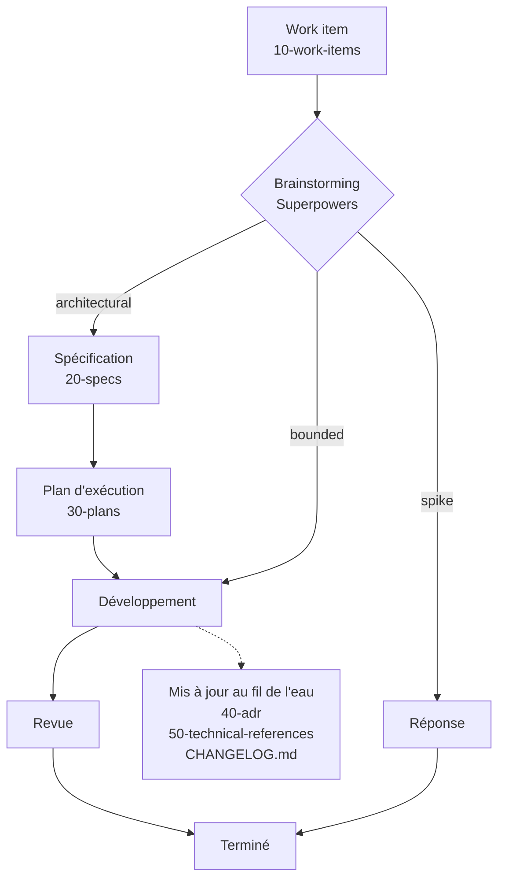

# Agent Memory Powers

[](LICENSE.txt)

> **Votre agent oublie. Votre dépôt, non.**

Agent Memory Powers est une structure documentaire à déposer dans un projet existant pour donner à un agent de codage IA une **mémoire écrite et durable du projet**. Chaque étape du travail — demande, spécification, plan, décision — laisse un document Markdown à un endroit prévisible, avec un propriétaire et une durée de vie clairs. Chaque nouvelle session de l'agent repart de ce que le projet sait déjà, au lieu de repartir de zéro.

Il est conçu pour [Claude Code](https://claude.com/claude-code) et pour fonctionner avec [Superpowers](https://github.com/obra/superpowers).

---

## Pourquoi

Un agent de codage IA commence chaque session la tête vide. Ce qui a été expliqué, décidé ou découvert lors de la session précédente est perdu s'il n'a pas été écrit — et quand il l'a été, cela finit le plus souvent éparpillé, périmé, ou en contradiction avec le code.

Ce modèle prend le contre-pied des moteurs de mémoire et des bases vectorielles : **la mémoire, c'est du Markdown, dans le dépôt**.

- Versionnée avec le code, relue comme le code.
- Lisible par les humains comme par les agents — ni base de données, ni serveur, ni dépendance à un outil.
- Organisée pour que l'agent sache toujours **où chercher, où écrire, et à quoi il ne doit pas toucher**.

## Principes

1. **Une place pour chaque chose.** Des dossiers numérotés, chacun dédié à un type de connaissance avec son propre cycle de vie. La numérotation suit le flux de travail : les dossiers se trient dans l'ordre où le travail les traverse.
2. **Des propriétaires clairs.** Chaque fichier et chaque dossier dit qui l'écrit : vous, l'agent, ou Superpowers. L'agent ne réécrit jamais le corps de vos work items, ne touche jamais à votre `TODO.md`, et ne lit même pas vos brouillons.
3. **Un flux qui écrit au fil de l'eau.** Work item → brainstorming → spécification → plan → code. Les décisions deviennent des ADR, les références techniques suivent le code, et le changelog trace chaque changement en face de son work item.
4. **Le code a le dernier mot.** Les documents sont une mémoire, pas la vérité. `AGENTS.md` dit explicitement à l'agent que le code source est la seule source de référence fiable.

## Fonctionnement



1. **Vous rédigez une demande.** `/create-work-item <titre>` crée un work item numéroté avec son front matter ; vous en écrivez le corps. Ou importez un ticket Jira existant avec `/create-work-item-from-jira <clé>`.
2. **Superpowers en fait le brainstorming avec vous** et le classe dans le champ `superpowers-class` du front matter :

   | Classe | Nature du travail | Suite |
   |---|---|---|
   | `spike` | Une question dont la sortie est une réponse, pas du code | Une réponse |
   | `bounded` | Un changement bien cerné dans du code existant | Développement direct |
   | `architectural` | Nouveau projet, nouveau sous-système ou changement architectural | Spécification, puis plan, puis développement |

3. **Spécification, puis plan.** Pour un travail architectural, Superpowers écrit une spécification dans `docs/20-specs` (*ce qui doit être vrai*), et l'agent passe le work item à `in-progress`. Une fois la spécification validée par vous, Superpowers écrit un plan d'exécution dans `docs/30-plans` (*comment y arriver*).
4. **Développement**, une fois le plan validé, selon cinq consignes inscrites dans `AGENTS.md` :
   - **Sequential only** — une tâche à la fois, jamais en parallèle ;
   - **Clean context** — chaque sous-agent ne reçoit que le contexte utile, avec les specs ;
   - **Adaptive effort** — puissance du modèle et profondeur de raisonnement adaptées à la difficulté de la tâche ;
   - **Strict review** — chaque livraison est vérifiée, rejetée si les specs ou les cas limites échouent, et corrigée avant l'étape suivante ;
   - **Compact memory** — le résultat validé est résumé dans le contexte principal, les logs intermédiaires sont abandonnés.
5. **La mémoire se met à jour au fil de l'eau.** L'agent propose une ADR dès qu'une décision est adoptée (vous confirmez), tient à jour la référence technique concernée et trace le changement dans `CHANGELOG.md`. Le `status` du work item suit le travail : `new` → `in-progress` → `review` → `done`.

## Structure du dépôt

```
.
├── AGENTS.md                      # le manuel de l'agent
├── CLAUDE.md                      # une ligne, « @AGENTS.md », pour Claude Code
├── ARCHITECTURE.md                # architecture logicielle uniquement, autonome
├── CODEMAP.md                     # carte du code, établie à partir des seules sources
├── CHANGELOG.md                   # historique concis des changements logiciels
├── TODO.md                        # le vôtre ; l'agent n'y touche jamais
├── README.md, LICENSE.txt         # propres à ce modèle ; ne pas recopier dans votre projet
├── _.gitignore                    # règles à reporter dans le .gitignore du projet
├── _.gitattributes                # modèle de .gitattributes (orienté .NET)
├── _.editorconfig                 # modèle d'.editorconfig (orienté .NET / C#)
├── docs/
│   ├── 00-knowledge-base/         # connaissance métier durable, dont 010-glossary.md
│   ├── 05-draft/                  # vos brouillons ; l'agent ne les lit pas
│   ├── 07-studies/                # études ponctuelles, rédigées à la demande
│   ├── 10-work-items/             # demandes d'évolution ou de correction
│   ├── 20-specs/                  # spécifications rédigées par Superpowers
│   ├── 30-plans/                  # plans d'exécution rédigés par Superpowers
│   ├── 40-adr/                    # Architecture Decision Records
│   ├── 50-technical-references/   # un thème technique par document
│   └── work-items-settings.json   # préfixe des work items locaux
└── .claude/skills/
    ├── create-work-item/
    └── create-work-item-from-jira/
```

Chaque dossier de `docs/` a son propre `README.md`, qui définit ce que contient le dossier et, sauf pour `05-draft/`, lui sert d'index, maintenu par l'agent.

## La carte de la mémoire

Chaque type de document a un propriétaire et une durée de vie. C'est ce qui permet à l'agent de faire confiance — ou non — à ce qu'il lit.

| Où | Ce qu'on y trouve | Écrit par | Durée de vie |
|---|---|---|---|
| `00-knowledge-base/` | Invariants et vocabulaire métier (`010-glossary.md`) | Vous | Durable |
| `05-draft/` | Brouillons et pré-analyses | Vous | Privé — l'agent ne le lit pas |
| `07-studies/` | Analyses du dépôt ou d'un sujet général | L'agent, à votre demande | Instantané — vrai à sa date de rédaction, jamais mis à jour |
| `10-work-items/` | La demande brute d'évolution ou de correction | Vous (corps) · l'agent (front matter seulement) | Historique — conservé pour mémoire |
| `20-specs/` | Ce qui doit être vrai une fois le travail fait | Superpowers | Par work item |
| `30-plans/` | Comment faire le travail, tâche par tâche | Superpowers | Par work item |
| `40-adr/` | Une décision, son contexte, ses conséquences et les alternatives écartées | Proposée par l'agent, confirmée par vous | Immuable — remplacée par une nouvelle ADR, jamais réécrite |
| `50-technical-references/` | Un thème technique par document | Créé par vous — ou par l'agent si vous acceptez sa proposition — et maintenu par l'agent | Vivant — mis à jour dès que le code change |
| `README.md` (du projet) | Présentation du projet et structure du dépôt | L'agent | Vivant |
| `CODEMAP.md` | Carte du code | L'agent | Vivant |
| `ARCHITECTURE.md` | Architecture logicielle | L'agent | Mis à jour au franchissement d'une frontière architecturale |
| `CHANGELOG.md` | Changements logiciels, chacun rattaché à son work item s'il existe | L'agent | Journal horodaté et concis |
| `TODO.md` | Votre liste de tâches | Vous | Interdit à l'agent |

Conventions de nommage :

- `00-knowledge-base/` et `50-technical-references/` : kebab-case, avec un préfixe numérique sur trois chiffres pour l'ordre d'affichage — `010-glossary.md`.
- `20-specs/` et `30-plans/` : `YYMMDD-<slug>.md`, ou `YYMMDD-<id>-<slug>.md` quand le document part d'un work item.
- `40-adr/` : `YYMMDD-<slug>.md`, daté du jour d'adoption de la décision.

## Les work items

Un work item est un fichier Markdown dont le front matter porte l'état :

```yaml
---
id: PRJ-0001
title: "Corriger le délai de connexion sur réseau lent"
status: new
superpowers-class: 
tags: []
---
```

| `status` | Positionné par |
|---|---|
| `draft` | Vous |
| `new` | La skill de création |
| `deferred` | Vous |
| `in-progress` | L'agent, à l'écriture de la spécification dans `20-specs` |
| `review` | L'agent, quand Superpowers arrive à la revue de code |
| `done` | L'agent, au commit final du développement |
| `canceled` | Vous |

`superpowers-class` est attribué par Superpowers lors de la classification. Les `tags` sont tenus par vous ; l'agent peut en proposer.

Deux familles de work items cohabitent :

- **Les work items locaux**, créés par `/create-work-item`, prennent le préfixe lu dans `docs/work-items-settings.json` et le numéro libre suivant, sur quatre chiffres — par exemple `PRJ-0001-corriger-le-delai-de-connexion-sur-reseau-lent.md`.
- **Les work items importés de Jira**, créés par `/create-work-item-from-jira`, gardent la clé du projet Jira et complètent le numéro à quatre chiffres — `PROJ-558` devient `PROJ-0558-<slug>.md`. Ils portent deux marques de plus : le tag `Jira` et un champ `jira: PROJ-558` qui garde la clé exacte du ticket.

L'agent ne modifie jamais que le front matter d'un work item. Seule exception : l'import Jira, qui écrit le corps à la création — et seulement à la création.

## Les skills

Le dépôt fournit deux skills, dans `.claude/skills/`.

### `/create-work-item <titre>`

Crée un work item numéroté et l'ajoute à l'index du dossier. Elle est volontairement défensive :

- elle n'écrase, ne renumérote et ne modifie jamais un work item existant ;
- elle ne retombe jamais sur un préfixe par défaut : un fichier de réglages illisible ou un `prefixe` vide l'arrête ;
- elle s'arrête si des work items portant le préfixe existent mais ne peuvent pas être lus, au lieu de repartir de 1 ;
- elle refuse un titre qui ne donne aucun slug, et redemande un titre ;
- elle n'écrit que le front matter : le corps est à vous.

### `/create-work-item-from-jira <clé>`

Importe un ticket Jira comme work item, puis pose le label `Claude` sur le ticket dans Jira, pour voir d'un coup d'œil quels tickets ont été confiés à l'agent. La skill nécessite un serveur MCP Atlassian (Jira) configuré dans Claude Code ; elle attend un seul site Atlassian et demande lequel retenir s'il y en a plusieurs.

- Le titre du ticket (avec son épopée parente), sa description et son lien sont écrits dans le work item ; les images sont remplacées par une mention renvoyant au ticket Jira.
- Le label n'est posé qu'une fois le fichier local créé, et les labels existants sont conservés. Si Jira refuse, le fichier local reste.
- Elle refuse un ticket déjà importé, et un ticket dont la clé de projet est identique au préfixe local.
- Tout le travail exact — validation de la clé, complément à quatre chiffres, refus des doublons, slug, échappement YAML — est fait par `compose.js`, couvert par des tests :

```bash
node .claude/skills/create-work-item-from-jira/tests.js
```

## Prérequis

- **[Claude Code](https://claude.com/claude-code)** — il lit `CLAUDE.md`, qui importe `AGENTS.md`, et trouve les skills dans `.claude/skills/`.
- **[Superpowers](https://github.com/obra/superpowers)** — pour le brainstorming, les spécifications, les plans et le développement.
- **[Node.js](https://nodejs.org/)** — utilisé par les skills.
- *Optionnel :* un **serveur MCP Atlassian (Jira)** configuré dans Claude Code, pour la skill d'import Jira.
- *Optionnel :* **[Obsidian](https://obsidian.md/)** — le dépôt s'ouvre comme un coffre (*vault*), ce qui rend agréable la navigation et les liens entre documents. `.obsidian/` est ignoré par git.

## Installation

Agent Memory Powers s'installe **dans un projet existant** : on y ajoute ses fichiers, puis on laisse l'agent remplir ce qu'il peut.

1. **Recopier les fichiers dans le projet** — tout, sauf `README.md` et `LICENSE.txt` qui décrivent le modèle lui-même, le dossier `.obsidian/`, et la configuration git et d'édition (`.gitignore`, `.gitattributes` et les modèles `_.*`), traitée à l'étape 4. Ne jamais écraser un fichier qui existe déjà dans le projet :
   - un `AGENTS.md` existant : y fusionner les sections de ce modèle ;
   - un `CLAUDE.md` existant : y ajouter la ligne `@AGENTS.md` ;
   - un dossier `.claude/` existant : y ajouter simplement `skills/`.
2. **Nommer le projet.** Dans `AGENTS.md`, remplacer **A COMPLETER** en première ligne par le nom du projet et une description d'une ligne.
3. **Configurer les work items.** Dans `docs/work-items-settings.json`, remplacer `XXX` par le code racine des tickets du projet. Choisir un code différent des clés de vos projets Jira : la skill d'import refuse un ticket dont la clé porte le préfixe local.
4. **Reporter la configuration git et d'édition**, à partir des modèles préfixés `_.` :
   - reporter dans le `.gitignore` du projet les lignes de `_.gitignore` : elles gardent les skills versionnées et les fichiers locaux d'Obsidian hors de git. Si votre `.gitignore` contient déjà une ligne `.claude/`, la remplacer par ces règles ;
   - vérifier la présence d'un `.gitattributes` dans le projet, sinon partir de `_.gitattributes` ;
   - de même pour `.editorconfig`, avec `_.editorconfig`.

   Ces deux derniers modèles sont pensés pour un projet .NET / Visual Studio : les adapter au besoin.
5. **Laisser l'agent amorcer la mémoire.** Dans Claude Code, passer les prompts suivants :
   - *Génère moi dans CODEMAP.md une code map du projet*
   - *Génère moi ARCHITECTURE.md en accord avec les directives décrites dans AGENTS.md*
   - *Analyse le projet et génère moi un glossaire des termes métiers dans docs/00-knowledge-base/010-glossary.md*
6. **Relire le glossaire soi-même.** Supprimer ce qui ne semble pas pertinent et ajouter les entrées qui le seraient plus : c'est le vocabulaire avec lequel l'agent raisonnera.
7. **Installer Superpowers** localement sur votre compte. Passer par sa marketplace permet de disposer des dernières versions — depuis la personnalisation de l'application Claude, ou dans Claude Code :

   ```
   /plugin marketplace add obra/superpowers-marketplace
   ```

   ```
   /plugin install superpowers@superpowers-marketplace
   ```

   Pour les autres options d'installation, voir le [README de Superpowers](https://github.com/obra/superpowers).

## Une journée avec Agent Memory Powers

1. `/create-work-item Corriger le délai de connexion sur réseau lent` crée `docs/10-work-items/PRJ-0001-corriger-le-delai-de-connexion-sur-reseau-lent.md`. Vous décrivez le problème dans son corps.
2. Vous demandez à Claude de faire le brainstorming du work item `PRJ-0001` avec Superpowers. Il lit le work item, pose ses questions, et le classe — disons `architectural`.
3. Superpowers écrit `docs/20-specs/YYMMDD-PRJ-0001-delai-de-connexion.md`, et l'agent passe le work item à `in-progress`. Vous relisez et validez la spécification.
4. Superpowers écrit le plan d'exécution dans `docs/30-plans/`. Vous le validez, et le développement démarre, une tâche à la fois, chacune revue avant la suivante.
5. En chemin, l'agent propose une ADR quand vous arrêtez une stratégie de nouvelle tentative, met à jour la référence technique sur le réseau, et trace le changement dans `CHANGELOG.md` en face de `PRJ-0001`.
6. Au commit final, le work item passe à `done`. La semaine suivante, une session toute neuve retrouve la demande, la spécification, le plan, la décision et la référence à jour, exactement là où elle les attend.

## Crédits

Agent Memory Powers est un projet indépendant, conçu pour fonctionner avec [Superpowers](https://github.com/obra/superpowers) de Jesse Vincent et Prime Radiant. Il n'est affilié ni à Superpowers ni à ses auteurs.

## Licence

[MIT](LICENSE.txt)
